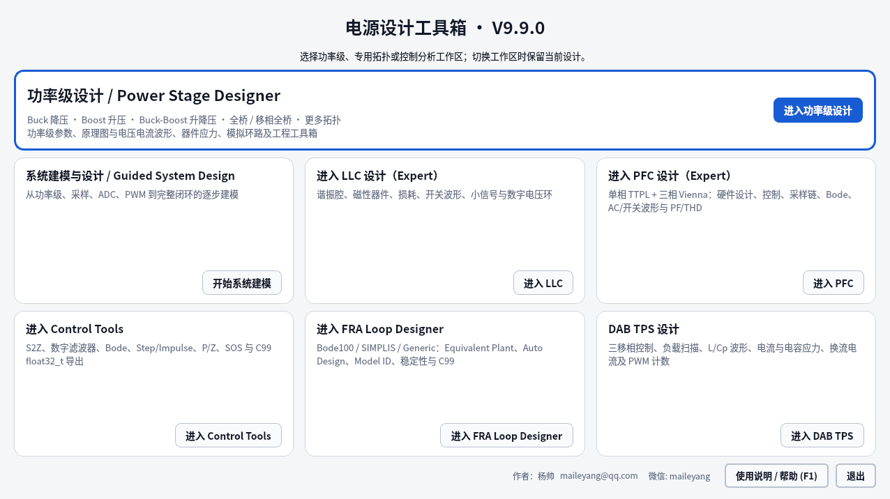
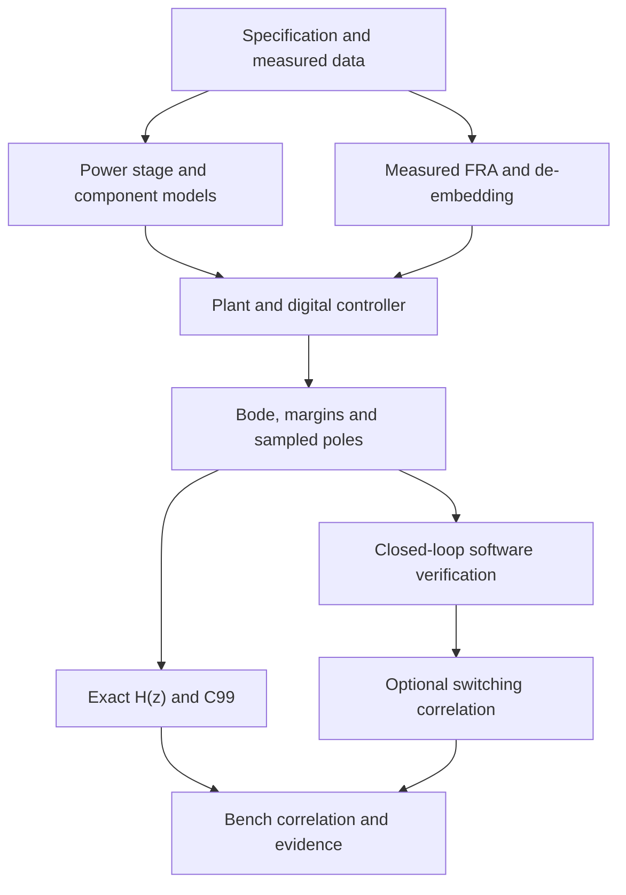
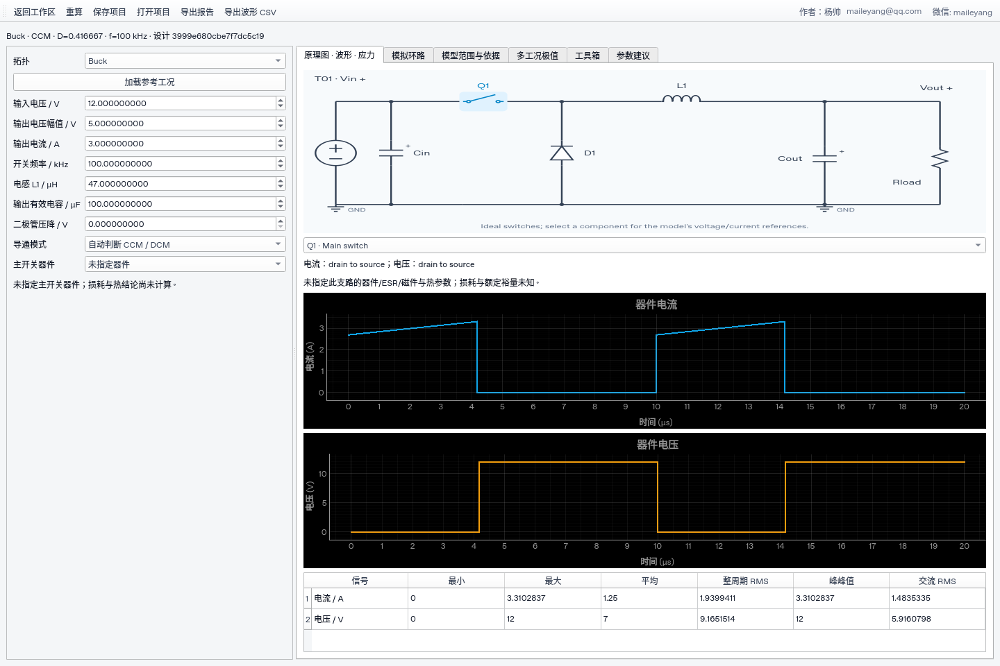
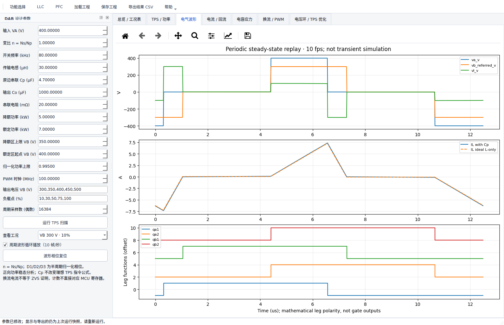
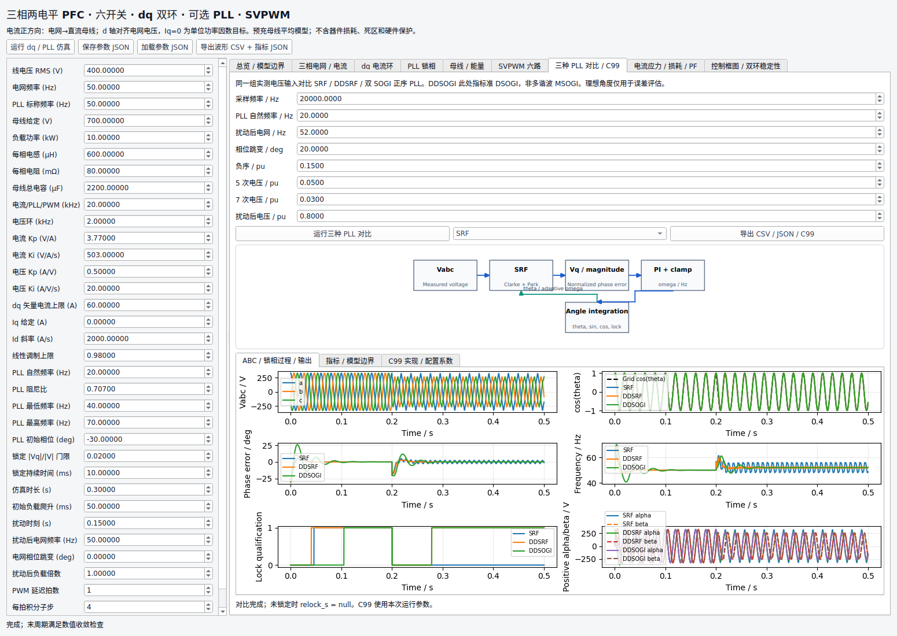

# Power Design Toolkit

> **Open-source power electronics CAE toolkit for power-stage design, LLC, PFC, FRA, digital control, C99 code generation and switching verification.**

Power Stage Designer · LLC · DAB TPS · Totem-Pole PFC · Vienna / Two-Level PFC · SRF / DDSRF / DSOGI PLL · Multi-harmonic PR · Magnetics · FRA · C99 · ngspice · Web / MCP

[](https://github.com/yangshuai2022-star/power-design-toolkit/actions/workflows/build-release.yml)
[](https://github.com/yangshuai2022-star/power-design-toolkit/actions/workflows/ngspice-smoke.yml)


[](https://github.com/yangshuai2022-star/power-design-toolkit/releases/latest)


Power Design Toolkit is an engineering-oriented power-electronics design and digital-control platform. It connects **power-stage design, component/loss screening, multi-fidelity models, measured FRA data, exact discrete controller H(z), stability analysis, C99 code generation, firmware-correlated switching co-simulation and Agent/API access** in one codebase.

**v9.9.0 development source:** Power Stage Designer, shared-waveform LLC/PFC analysis, integrated LLC resonant magnetics, source-backed CSC selection, corrected actual circuit drawings and session/export safeguards. Complete Linux application/long-test and installed-wheel/frozen checks have passed on the exact sources documented in the validation report. Native Windows/macOS full-suite and frozen qualification is still in progress. Ordinary three-screen native LLC flows now pass; the next follow-up corrects a whole-widget scrolling test while retaining all real UI and numerical gates. Formal release remains paused. The published [v9.8.1 binary baseline](https://github.com/yangshuai2022-star/power-design-toolkit/releases/tag/v9.8.1) predates these additions. See [validation and exact source identities](docs/PSD_VALIDATION_REPORT.md) and [Install and run](#8-install-and-run).

Reproducible [LLC Two-Stage GUI/CLI input examples](examples/llc_two_stage/README.md) include a nominal WARN candidate with explicit Apply/save/report steps and a physically rejected candidate that must remain unavailable for Apply. They preserve the 20% validity gate and distinguish nominal TD losses from the remaining FHA workpoints.

## Current capabilities

One toolkit connects power-stage design, magnetics, loss estimation, voltage/current waveforms, control-loop design, measured FRA, digital coefficients and C99 export.

| Module | Implemented capabilities | Workspace / documentation |
|---|---|---|
| **Power Stage Designer** | 19 direct periodic stage models, existing LLC HB/FB integration, component-linked voltage/current and total/AC RMS, target-driven parameter suggestions, analog loops, calculators, corner scans and reproducible projects/reports | Power Stage Designer; [scope and feature matrix](docs/PSD_FEATURE_MATRIX.md) |
| **LLC resonant converter** | FHA, multi-harmonic HB, switched time-domain analysis, gain/ZVS maps, primary/SR device libraries, magnetics, digital voltage control, interleaving and optional ngspice correlation | LLC Design; [model hierarchy](docs/LLC_MODELING.md) |
| **DAB TPS** | Operating-point sweeps, periodic L / L+Cp solutions, power/backflow/capacitor stress, PWM counts, automatic calculation on point selection and 10 fps periodic replay | DAB TPS; [model conventions](docs/DAB_TPS_AND_THREE_PHASE_DQ.md) |
| **DAB digital control and optimization** | PI→Pcmd→TPS→Vout small-signal model, discrete Bode/poles, reference/load steps, controller import/C99, constrained optimization and quantized-candidate checks | DAB → Voltage Loop / TPS Optimization; [engineering notes (Chinese)](docs/engineering-expansion.md#dab-电压环与约束优化) |
| **Single-phase Totem-Pole PFC** | L/C sizing, device/capacitor/thermal analysis, PF/THD, zero-crossing/minimum-pulse behavior, sensing and dual-loop control, exact H(z), C99 and shared-ngspice closed loop | PFC → TTPL Engineering; [workflow](docs/PFC_ENGINEERING_WORKSPACE.md) |
| **Three-phase two-level PFC** | Six-switch SVPWM, decoupled dq dual-loop control, three selectable PLLs, frequency/phase/load disturbances, multi-rate stability, and device/inductor/capacitor stress and loss | PFC → Three-Phase Two-Level dq / PLL |
| **Vienna PFC** | ABC current control, DC-bus/midpoint balance, three-level modulation, sectors/waveforms, RMS/peak currents, PF/ITHD, device/core/capacitor losses and two center-switch implementations | PFC → Vienna; [analysis scope (Chinese)](docs/engineering-expansion.md#电流损耗与效率的范围) |
| **Three-PLL comparison** | SRF, DDSRF and dual-SOGI positive-sequence PLLs under identical inputs; locking, phase error, frequency ripple, ABC/positive-sequence outputs, diagrams, CSV and C99 | Two-Level / Vienna → PLL Comparison; DDSOGI denotes DSOGI here |
| **Digital control and multi-harmonic PR** | PI/PIF/PID/Type-II/III and more; selectable quasi-PR harmonics 1/3/5/7/9/11, branch/combined Bode, float32 coefficients and C function export | Control Tools; [PR equations and coefficients (Chinese)](docs/MULTI_PR_AND_MAGNETICS.md) |
| **Core/material database** | 46 complete core/bobbin presets and 137 legacy references, plus 630 explicit CSC part numbers, 318 source-specific geometries and 44 printed bias/loss formulas; source/conflict tracking, bounded calculations and saved identity | LLC → Transformer Design → Core Catalog; PFC → TTPL / Vienna → Inductor Design → CSC PDF source catalog |
| **Magnetic models and complex impedance** | Waveform-based iGSE, Litz/Dowell loss, complex-impedance fitting/SPICE, and an optional 3C90 residual model that passed an independent-test gate | [Magnetic modeling, data and AI validation (Chinese)](docs/engineering-expansion.md#ai-的独立验证与接入边界) |
| **FRA and measured tuning** | Bode100/SIMPLIS/CSV import, existing-controller de-embedding, Fc/PM/GM/Ms/Mt, automatic design, measured PI tuning map and MATLAB/Python research exports | FRA Loop Designer; [measured tuning map](docs/FRA_TUNING_MAP.md) |
| **Web / Agent** | FastAPI/Web and MCP interfaces backed by shared deterministic kernels | [Web](docs/WEB_DEPLOYMENT.md) / [MCP](docs/AGENT_MCP.md); desktop additions do not automatically add API coverage |

**Source and binary releases:** This page describes its source checkout; unpublished additions are identified above. Check the corresponding Release notes for features included in a binary package. The latest additions provide software models and data-based validation; they do not establish hardware closed-loop or high-voltage validation. Power Stage Designer, DAB and three-phase additions primarily target desktop/Python use; new Web/MCP coverage is not implied. C99 exports provide controller/PLL reference functions without board-specific PWM/ADC drivers.

**Latest engineering additions:** [Detailed notes, limitations and reproduction (Chinese)](docs/engineering-expansion.md) · [Control validation](docs/benchmarks/control_validation.json) · [Independent magnetic-model test](docs/benchmarks/magnetic_ai.json) · [Optimization comparison](docs/benchmarks/dab_optimization.json) · [Regression scope (Chinese)](docs/benchmarks/regression.md)

**Latest reliability audit:** Fixed stale controller exports, out-of-order PFC results, DAB Cp linearization/discrete-model consistency, and LLC three-phase waveform rendering. Each workspace shows **Author: 杨帅 / Yang Shuai**, email and WeChat in the existing upper-right toolbar row. The launcher puts **功率级设计 / Power Stage Designer** first, with direct Buck/Boost/Buck-Boost/full-bridge descriptions and all existing workspace entries retained. See [the earlier UI audit](docs/UI_ALGORITHM_AUDIT.md) and [current PSD/shared-consumer validation](docs/PSD_VALIDATION_REPORT.md).

The project is built around four rules:

1. **One engineering model, multiple front ends.** Desktop GUI, CLI, Web/API, MCP and code generation reuse shared Python kernels instead of re-implementing equations in each interface.
2. **Exact digital-control semantics.** A designed discrete transfer function is passed as its real `b/a` coefficients; it is not silently re-fit into a different PI/PID form or re-discretized inside downstream simulation.
3. **Model boundaries are explicit.** FHA, HB, switched time-domain, measured FRA, small-signal Bode, firmware runtime and ngspice answer different questions.
4. **Evidence is not collapsed into one word.** Software regression, simulator execution and hardware validation are separate evidence levels.

Completed LLC and TTPL PFC control analyses can be exported as standalone
**MATLAB `.m` / Python `.py` research scripts**, with exact controller coefficients,
sample times, explicit frequency-data boundaries and numerical self-checks.
See [Research model export](docs/RESEARCH_MODEL_EXPORT.md).

Digital Control Tools also includes a **parallel multi-harmonic quasi-PR** page
(1/3/5/7/9/11, branch/total Bode, float32 coefficients and C99 functions).
PFC inductor results provide measured complex-impedance fitting and SPICE export.
See [Multi-harmonic PR and magnetics](docs/MULTI_PR_AND_MAGNETICS.md).



*Actual development-source Qt capture at 1280×720, 100% scale: the first-level Power Stage Designer entry and every existing workspace are visible. This Linux/offscreen capture does not qualify native Windows/macOS display scaling.*

---

## 1. 30-second engineering workflow



A typical LLC path is:

```text
400 V -> 53 V / 3 kW specification
    -> Lr / Cr / Lm and operating region
    -> primary / SR device selection and comparison
    -> FHA / HB / switched-TD comparison
    -> digital voltage-loop model
    -> exact H(z) controller
    -> PM / GM / sensitivity checks
    -> C99 float32_t export
    -> shared-ngspice switching correlation
    -> traceable evidence matrix
```

A typical single-phase TTPL PFC path is:

```text
Vin / Vbus / Pout / fsw specification
    -> Lboost / Cbus sizing
    -> MOSFET / loss / thermal screening
    -> settled AC line cycle / PF / THD
    -> switching / zero-crossing verification
    -> sensing / ADC / current + voltage loop design
    -> exact current + voltage H(z)
    -> C99 contract
    -> float32 sensing / ADC / delay / anti-windup / zero-cross runtime
    -> shared-ngspice four-switch closed loop
    -> hardware correlation
```

The first maintained reference case is [`LLC_400V_53V_3kW`](reference_designs/LLC_400V_53V_3kW/README.md). Its bench status is intentionally `UNKNOWN`; software evidence is not presented as hardware sign-off.

---

## 2. Six engineering workspaces

The desktop launcher opens six independent workspaces while preserving state during switching, plus Guided System Design.

| Workspace | Main purpose | Typical outputs |
| --- | --- | --- |
| **Power Stage Designer** | General converter stages, component-linked schematics/waveforms, analog-loop design and engineering calculators | Periodic voltage/current, peak/average/total and AC RMS, L/Lm/turns-ratio suggestions, Type II/III R/C values, margins, explicit corner extrema, project JSON, waveform CSV and printable HTML |
| **LLC Design** | Resonant tank, operating region, Q/ZVS, magnetics, primary/SR devices, interleaving, waveforms, small signal and digital voltage loop | Lr/Cr/Lm, gain map, device/loss comparison, stress data, FHA/HB/TD comparison, Gvf(s/z), exact H(z), PM/GM, shared-ngspice closed-loop verification |
| **DAB TPS** | TPS operating points, sampled voltage-loop design and constrained optimization | D1/D2/D3, periodic playback, L/L+Cp waveforms, stresses, Pcmd→Vout model, Bode/poles, closed-loop steps, PWM-verified candidates, coefficients/C99 and JSON/CSV; ZVS remains UNKNOWN |
| **PFC Design** | TTPL, three-phase two-level dq and Vienna | Topology-specific current/voltage control, PLL comparisons, sizing/stress/loss, PF/THD, Bode, coefficients/C99; shared-ngspice closed loop currently for TTPL |
| **Control Tools** | Digital controller/filter and parallel multi-harmonic quasi-PR design | H(s)/H(z), Bode, step/impulse, poles/zeros, SOS/DF2T, selectable PR harmonics 1/3/5/7/9/11, float32 coefficients, C99 |
| **FRA Loop Designer** | Controller design from measured frequency response | Bode100/SIMPLIS import, controller de-embedding, Equivalent Plant, Fc/PM/GM/Ms/Mt, Auto Design, model ID, C99 |

The PFC workspace includes a separate **six-switch two-level dq plant** with
SRF/DDSRF/dual-SOGI PLL selection, decoupled current loops, voltage PI, SVPWM,
and frequency/phase/load disturbances. The source angle is used only to
generate the grid and evaluate error, never as controller feedback. Both
three-phase topologies provide carrier-reconstructed stress/loss analysis and
an independent PLL comparison experiment. See [model contracts](docs/DAB_TPS_AND_THREE_PHASE_DQ.md)
and [the current expansion](docs/engineering-expansion.md).

### Power Stage Designer: specification → waveform → loop → report

Click the first launcher card, **功率级设计 / Power Stage Designer → 进入功率级设计**, or run `python -m power_stage_design`. Choose Buck, Boost, Buck-Boost or Full Bridge in the topology selector, edit the operating point, then click a physical schematic component to inspect its own voltage/current and stress statistics. On a short display, scroll the stage panel or collapse its schematic to view both plots and stress statistics together. The stage solver, component view, CSV and HTML report use the same calculated result.

- **Direct stages:** Buck, Boost, inverting Buck-Boost, Fly-Buck, two-switch Buck-Boost, SEPIC, ZETA, Ćuk, Flyback, two-switch Flyback, QR Flyback, active-clamp Forward, Forward, two-switch Forward, Half Bridge, Push-Pull, Full Bridge, phase-shifted Full Bridge and series-capacitor Buck. LLC Half Bridge and Full Bridge open the existing LLC engine with the selected bridge identity.
- **Declared physical domains:** Buck/Boost/Flyback support ideal periodic CCM/BCM/DCM with finite diode drop. Other stages retain their individual reset, load, ripple, commutation and conduction-mode restrictions; the topology name does not imply every operating mode. The ideal models remain available. An opt-in **Advanced physical parameters** tab adds explicit two-switch Coss/Ron/diode/winding dynamics, QR valley/delay/charge-curve and finite-Ron root policies, and a seven-state constant-Coss PSFB commutation model. Parameters, source and model revision are saved with each project. These are declared independent circuits/controllers, not inferred TI policies or hardware ZVS qualification. Their detailed bounds and acceptance evidence are in the feature matrix.
- **Parameter suggestions:** explicit ripple/duty/reflected-voltage targets produce L/Lm/turns-ratio proposals as applicable. Preview the achieved values, explicitly apply, and recompute. Saved provenance retains targets and achieved values. These are single-operating-point suggestions; scan corners separately. Half Bridge, Push-Pull and Full Bridge suggestions include ordinary and joint magnetic-state CCM/BCM/DCM branches, with achieved ripple and duty checked by the actual forward solver. PSFB also accepts an explicit Lm ripple target; untargeted Lm and physical options remain user supplied. The half-bridge split capacitors enforce a fixed total DC bus and a declared 10% individual-ripple limit. Advanced two-switch Buck-Boost/PSFB proposals preserve their explicit physical options through Apply, project restoration and reports.
- **Analog loops:** Buck VMC with Type II/III is the starting workflow. The complete calculator provides six strict-CCM plants: Buck VMC and peak-CMC Buck, Boost, inverting Buck-Boost, Forward and Flyback. Five physical compensation networks cover Type II, transconductance Type II, Type III, isolated Type II with Zener clamp, and isolated Type II with inner loop. An explicit exact integrator-branch action is available for the eligible networks, with the TI approximate-setting discrepancy explained. Ordinary edits refresh the current Bode analysis automatically. Target Fc/PM and preferred-series intent is saved separately from achieved results; synthesis reanalyzes the realized R/C values; finite amplifier, optocoupler and slope-compensation assumptions remain explicit. This analog analysis does not imply digital ADC/computation-delay qualification.
- **Toolbox:** FET loss screening, load-step capacitance, capacitor current sharing, AC/DC bulk and hold-up capacitance, RCD/RC snubbers, preferred-value dividers, analog/GPIO output scaling, unit conversion, and LC/π filters with damping. Toolbox parameters have their own JSON save/open and result exports, with page-local imported-source identity, debounced current-result refresh and cancellable heavy file-open recomputation. Desktop capacitor sharing is single-frequency; explicit harmonic spectra are a Python feature. The published bulk-capacitor RMS approximation is not thermal-validated periodic RMS.
- **Corner scans:** explicit Vin/load/component-tolerance combinations evaluate the same compensator, with per-metric worst-point identities. Unscanned regions and unknown total losses remain unverified.
- **Reproducibility:** project JSON preserves full-precision inputs, model/controller/device snapshots, suggestions and scan requests. Reopening validates and recomputes; saved hashes or historical results are not fresh evidence. Input changes, stale asynchronous results and modal export races invalidate obsolete output. Export the current waveform CSV or printable HTML report, including matching loop and corner results.

**Related LLC/PFC/control fixes:** LLC HB/FB component selection now links primary/SR devices, windings and tank/output components to the same waveform result, including Co ESR and the modeled series resistance. Full Bridge also exposes signed DC-bus current and bus voltage. The ideal Half Bridge model does not resolve the redundant midpoint sources individually, so that source current remains explicitly unavailable. Accepted periodic TD waveforms feed semiconductor, magnetic, capacitor and damping calculations only for the matching converged operating point. PFC can use one qualified signed switched line-cycle source for PF/THD, device/capacitor losses, thermal screening and exports; incomplete PWM coverage cannot silently become full-period thermal evidence. Selected-device/bank overlays remain separate from the simulated circuit and require an electrical rerun after component changes. LLC SPICE dead-time current paths and PFC signed-current feedback were also repaired. Exact H(z)/FRA sessions preserve leading-zero delays and full-precision coefficients; stale analysis/candidate/export results are rejected across the existing workspaces.

**LLC two-stage optimization:** the LLC workspace now has a bounded Stage-A FHA → Stage-B TD candidate page. Choose nominal-only or critical-point verification, inspect each candidate's exact source/loss scope, then explicitly Apply. Reopened candidate records are historical only until rerun. The CLI opt-in is `llc-design optimize --config project.json --profile current --two-stage --verification-scope nominal --top-n 1 --max-candidates 1 --output new-run-directory`. Two-stage output requires a **new directory** so rejected reruns cannot mix current metadata with old accepted reports. Rejected/UNKNOWN candidates produce evidence and a nonzero exit; they never fall back to an accepted FHA report. The existing command without `--two-stage` retains Stage-A behavior.

**Controller export evidence:** the LLC, Control Tools and FRA exact C99 paths release a usable header only after the actual host float32 compile/run check passes. FAIL or NOT_RUN headers are compile-blocked diagnostics with hash-bound evidence. PFC semantic firmware templates separately label configuration checks, numerical verification and hardware status. A host-gcc PASS does not qualify an MCU, ISR timing or a board.

**Acceptance boundary:** the register covers 33 top-level stage/tool items, 11 nested loop plant/network items and six enhancements, for 50 explicit IDs. Its 30 verified-in-scope and three partial top-level labels are bounded capability labels, not release or hardware certification. Two-switch Buck-Boost, QR Flyback and PSFB retain unverified exact TI executable policies. Separately, unsupported model domains include asymmetric bridge/reset behavior, nonlinear commutation and zero-load/burst extensions where their rows exclude them; missing device/thermal data remain unknown. The integrated repairs now pass complete local regression and actual wheel/Linux frozen checks on their documented source identity. The separate CI file-dialog test correction and native Windows/macOS packages still require qualification. Existing measured-FRA analysis remains available; these software results do not establish new bench correlation, thermal/EMI or hardware safety. See the [per-priority topology scope](docs/PSD_FEATURE_MATRIX.md#latest-application-qualification-and-supported-scope-2026-10-19).

See the [feature matrix](docs/PSD_FEATURE_MATRIX.md), [validation report](docs/PSD_VALIDATION_REPORT.md) and [development status](docs/PSD_DEVELOPMENT_STATUS.md) for the supported domains, independent checks and remaining gates.



*Actual Linux/offscreen Qt capture after opening and recomputing the included [Buck + VMC loop project](examples/power_stage_design/buck-loop.json); the stage waveform tab is shown. This is not a native Windows/macOS package test.*

### DAB: operating point → controller → Vout

Selecting **Operating point** automatically starts calculation when
needed. Electrical waveforms can replay at a 100 ms frame interval, with pause
and phase reset. This replays one computed steady-state period; it does not
manufacture a transient simulation.

The **Voltage Loop / TPS Optimization** tab reuses LLC digital-controller coefficients and adds:

- PI or imported C(z) → power command → TPS → capacitor/load → Vout;
- local power-map linearization, matched discrete bus-energy update and sample delay, Bode and discrete poles;
- reference/load steps with nonlinear bus-energy integration and command limits;
- formula/grid/multi-start constrained-search comparison and PWM-count checks;
- frozen JSON snapshots and portable controller C99.

The optional Cp path is a **periodic power map**, not a complete Cp/L transient
state-space model. The optimizer uses exact ideal-L segment integrals and does
not claim global optimality or ZVS proof.



The FRA toolbar also opens a [measured PI tuning map](docs/FRA_TUNING_MAP.md): bind each scan to its actual controller and operating point, compare rounds on a sparse Kp×Ti map, and plan a local next scan. Predictions remain separate from measurements; no hardware parameters are applied.

### Smart Control / Guided System Design (v9.8.1)

From the launcher, **Guided System Design** builds a canonical closed-loop definition for LLC FM voltage-loop or single-phase Totem-Pole PFC (current + bus voltage), then hands it into the existing design/control engines. An interactive **Fc–PM Solution Map** synthesizes Tustin PI candidates for explicit application in the LLC/TTPL workspaces.

The eight-step workflow is **Topology → Power Stage → Sensing → ADC → Modulator → Timing → Controller → Review**, with live summaries and guided-definition re-entry. LLC envelope/ZVS/FHA–TD/loss-provenance/thermal/optimizer foundations are described in [LLC Physics Model V2](docs/LLC_PHYSICS_MODEL_V2.md).

v9.8.1 makes the assessment and its limits explicit:

- **Actual LLC output headroom:** static normalized-PCMD headroom uses the active PI/PIF/2P2Z controller's `output_min/output_max`, intersected with the FM LUT's reachable PCMD range and the actual 0–1 clamp. For example, PCMD 0.75 with an upper limit of 0.6 gives **−0.15** upper headroom and a saturation warning. External H(z) without an absolute output-limit contract remains `UNKNOWN`; this is not a transient anti-windup test.
- **Conditional adoption:** `FEASIBLE` means configured checks pass within the analyzed frequency band. Missing Fsw attenuation or required phase-crossover/GM evidence can produce `CONDITIONAL`. Review the reasons, enable **Allow conditional PI (unverified Fsw / GM)**, then explicitly **Apply conditional PI**. This does not upgrade missing evidence to a pass; `UNKNOWN` candidates and known constraint failures still block Apply.
- **One PI across retained points:** analyze a real operating point, click **Retain current**, then repeat and select compatible snapshots. The nominal PI is evaluated unchanged at every selected point, with per-point results and worst observed metrics. Uncollected load/voltage/temperature/tolerance conditions remain unverified; missing pole-stability evidence remains `UNKNOWN`.
- **Traceable exports:** Apply preserves conditional reasons, constraints, per-point results, exact controller identity and model/response signatures in LLC project JSON, MATLAB/Python research metadata, LLC/TTPL C99 design snapshots and TTPL H(z) manifests. Changed inputs, models, controllers or selected points invalidate stale candidates/evidence.

#### Save and reopen LLC / TTPL control sessions

LLC **Save project JSON** includes the control session; the PFC toolbar provides **Save / Open TTPL session**. Sessions preserve full-precision controller and model inputs, hidden sampling/sensing/timing fields, retained points, constraints and historical candidate/applied evidence. Legacy LLC spec/project files remain readable. This covers LLC/TTPL control design, not every workspace or FRA measurement session.

Reopening restores inputs and history only. Saved curves, hashes and PASS/CONDITIONAL assessments are not fresh validation: Apply is disabled and conditional permission is reset. **Run the model again → regenerate candidates → explicitly Apply.** A selected point that cannot be recomputed blocks candidate generation until it is successfully rebuilt or explicitly deselected/removed. Files are validated before changing the current session and saved atomically.

See [Smart Control evidence, common operating points and sessions (Chinese)](docs/smart_control_common_corners.md). These changes add software/model evidence, not hardware measurements, real ISR timing qualification or new float32 validation.

The measured FRA PI experiment map and MATLAB/Python research exports remain available. Measured scans and local predictions stay separate; rational models and frequency-response data retain their declared boundaries. Python research scripts are regression-tested; MATLAB runtime execution has not been validated.

Roadmap placeholders for other topologies are shown explicitly — they are not silently claimed as supported. Solution Map synthesis currently targets Tustin PI. Some advanced physics paths remain API/opt-in and are not yet integrated into every default GUI/PDF/Web consumer; see the explicit [model limitations](docs/LLC_MODEL_VALIDATION_REPORT.md).

---

## 3. LLC capability

### Electrical design and multi-fidelity analysis

The LLC workspace keeps several model levels instead of forcing one solver to do every job:

- **FHA** — fast fundamental-harmonic design baseline for tank synthesis, gain and operating-point work.
- **Nonlinear multi-harmonic HB** — selected odd harmonics with rectifier commutation/polarity coupling.
- **Internal switched time-domain solver** — piecewise nonlinear switching model with periodic steady-state solution.
- **shared-ngspice verification** — optional circuit-level switching correlation driven by the toolkit's discrete controller runtime.

The analysis also includes multi-load Q/gain maps, theoretical and engineering ZVS regions, operating trajectories, waveform reconstruction, transformer/resonant-inductor design, synchronous-rectifier timing/loss analysis, and fixed 2-phase/3-phase interleaved LLC analysis.

### Primary / SR device library

The LLC workspace includes built-in engineering-reference MOSFET records for primary and synchronous-rectifier positions, plus a persistent user library.

Current device-library workflow includes:

- Primary MOSFET and SR MOSFET selection;
- create / edit / clone / delete user records;
- JSON import/export;
- built-in reference data kept separate from user data;
- device comparison using the current LLC operating point;
- conduction, turn-off, gate, Coss/deadtime and ZVS-margin related screening where the model provides the required data.
Built-in generic/reference devices are not presented as vendor hardware sign-off. Datasheet curves and traceable vendor provenance remain a higher-fidelity data layer.

### Digital voltage-loop chain

```text
Vref
 -> C(z)
 -> PCMD clamp
 -> PCMD/Frequency or PCMD/TBPRD FM block
 -> PWM / ZOH / timing delay
 -> Gvf
 -> Vout
 -> analog sensing
 -> ADC / multi-SOC / recursive averaging
 -> feedback
```

The analyzer reports detected gain/phase crossovers, phase/gain margins, sensitivity/complementary sensitivity, delay envelopes, discrete closed-loop poles, command headroom and polarity diagnostics.

### Searchable transformer core / bobbin data

Transformer design now provides search, shape filtering and parameter loading
from **46 complete presets**, including 44 source-traced TDK core/bobbin pairs.
Another **137 legacy records** remain searchable as reference data. Incomplete
records and geometry conflicts are visible; core-window area is kept separate
from usable bobbin winding area. Material fits and geometric/thermal assumptions
retain their source pages, rows and warnings.

The catalog also opens measured sinusoidal core-loss CSV comparison and an
optional bounded 3C90 waveform predictor. It never substitutes that predictor
for PC40/PC44 or another material. See [magnetic validation (Chinese)](docs/engineering-expansion.md#数据库与磁计算基准).

### Integrated LLC resonant magnetics

The LLC global input panel offers **磁件结构 / 集成谐振漏感** alongside the
separate-Lr default. Supply a declared two-winding inductance matrix or consistent
open/short measurements to derive Lr, APR Lm and the effective electrical ratio
together. Physical core flux, winding geometry and loss use the actual turns ratio;
the shared transformer has no duplicate external-inductor loss or thermal node.

The winding screen includes insulation spacing, required build and unreachable
leakage targets. Its labeled reference examples are software models, not tested
hardware. Saved inputs, calculation books and formula PDFs retain source identity,
the physical/APR distinction and geometry limits. See the [integrated LLC workflow](docs/magnetics/integrated_llc_workflow.md)
for input definitions and the two-winding/full-bridge-secondary scope. Five
independent actual consumer/identity/boundary/projection/TD-label checks pass on
application source `4f9f5b4`; the installed wheel and actual Linux frozen runtime checks also pass. Native Windows/macOS qualification remains separate and pending.

### Source-backed powder-core selection

The added CSC reference catalog preserves **630 printed part numbers**, **318
source-specific geometry records**, **1,294 availability rows** and **44 printed
bias/loss formulas** from the supplied 2025 catalog. These counts are separate:
a geometry or an availability row is not a manufactured SKU. Three companion
documents remain separately searchable, including their application example and
source conflicts. The original PDFs are not bundled as application assets.

Open **PFC → TTPL Engineering / Vienna → 电感设计 → CSC PDF 来源磁环**.
Search a printed part, inspect its source pages and missing fields, and calculate
zero-bias inductance or bounded native-unit formula references. **保存磁件工程**,
**打开磁件工程** and **磁件报告** preserve the selected source snapshot and
recompute its outputs. The LLC transformer catalog also exposes these records as
reference data; powder-core geometry does not become a complete ferrite/bobbin
preset.

Full PFC reference estimation requires an explicit, saved user model declaration
when the PDFs do not define the loss-flux convention, waveform or application
range. Defaults remain UNKNOWN. Conflicting identities cannot be overridden by a
generic declaration, and legacy High Flux coefficients are never silently used.
The worked 120 kHz / 1 kW document is an arithmetic replay of its own assumptions,
not a production-solver acceptance case or manufacturer/hardware qualification.
Current source/consumer and final artifact acceptance are tracked in the
[validation report](docs/PSD_VALIDATION_REPORT.md).

### ngspice boundary

The current ngspice layer is a **switching-correlation model**, not a vendor semiconductor sign-off model. It does not claim release-accurate nonlinear Coss commutation, Qrr, switching loss, ringing or SR device stress.

See [ngspice closed-loop architecture](docs/NGSPICE_CLOSED_LOOP.md).

---

## 4. PFC capability

### Single-phase TTPL Engineering Workspace

The TTPL path is organized as an explicit eight-stage engineering workflow:

```text
1. Power Stage / Sizing
        ↓
2. Devices / Loss
        ↓
3. Capacitor / Thermal
        ↓
4. AC Line / PF / THD
        ↓
5. Switching / Zero Crossing
        ↓
6. Control / Sensing / Bode
        ↓
7. Exact H(z) / C99
        ↓
8. Closed-Loop Verification
```

#### Power stage / hardware sizing

The deterministic engineering kernel covers specification-to-hardware calculations including:

- low-line input RMS/peak current;
- duty trajectory over the AC half-cycle;
- boost-inductor ripple scan and required `Lboost`;
- twice-line bus-ripple capacitance requirement;
- hold-up capacitance requirement;
- physical capacitor-bank selection and ESR transfer into downstream models.

#### Devices / loss / thermal

TTPL device screening includes HF active/synchronous positions and the line-frequency leg. The device database supports packaged records plus persistent user JSON records. Loss/thermal calculations remain engineering screening models; nonlinear vendor Coss/Qrr/Eon/Eoff surfaces and detailed heatsink/airflow correlation are separate fidelity layers.

#### AC line / PF / THD / switching

The time-domain PFC path provides:

- settled AC-line-cycle reconstruction;
- signed grid current versus rectified inductor current semantics;
- PF, displacement/distortion factor and integer-harmonic THD;
- DC-bus ripple and capacitor RMS current;
- selected-workpoint switching waveforms;
- minimum-pulse and zero-crossing state-machine observability.

#### Exact H(z) and C99 handoff

The analyzed current and voltage controllers are promoted into a formal `PFCControlHandoff` containing exact normalized `b[]`, `a[]`, sample rates, limits, provenance and nonlinear implementation semantics.

```text
H(z) = (b0 + b1 z^-1 + ...)/(1 + a1 z^-1 + ...)
y[n] = sum(b[k] x[n-k]) - sum(a[k] y[n-k])
```

Downstream PFC simulation consumes those coefficients directly. **No Kp/Ti reconstruction and no second S-to-Z conversion are allowed in the closed-loop handoff.**

The Exact H(z) stage can export the JSON contract and an audited C99 package.

#### Firmware-correlated shared-ngspice closed loop

The TTPL closed-loop verifier now connects the frozen H(z) controllers to a four-switch shared-ngspice power stage. The current fidelity layer includes:

- float32 controller/state execution;
- PI/PIF conditional-integrator anti-windup derived from the frozen discrete controller identity;
- 2P2Z clamped-output history semantics;
- configured analog sensing poles;
- ADC-resolution quantization in calibrated engineering units;
- multi-SOC recursive averaging and digital filtering;
- configured control/computation/PWM timing;
- PWM shadow-application timing;
- eight-state TTPL zero-crossing runtime with PI reset and commutation states;
- line-polarity-aware HF/LF gate scheduling;
- real `libngspice` continuous inductor/capacitor state between digital events.

This is **firmware-correlated switching co-simulation**, not a claim of instruction-level C2000 bit identity. The current schema does not yet encode board-specific ADC common-mode offset/rail clipping, full MCU peripheral register behavior, vendor nonlinear semiconductor models, layout parasitics or protection-state-machine hardware correlation.

See [PFC Engineering Workspace](docs/PFC_ENGINEERING_WORKSPACE.md), [Exact H(z) handoff](docs/PFC_EXACT_HZ_HANDOFF.md) and [ngspice closed-loop architecture](docs/NGSPICE_CLOSED_LOOP.md).

### Three-phase Vienna PFC

Vienna currently includes:

- DC-voltage outer loop plus stationary-frame ABC current loops;
- split-bus midpoint balance loop;
- three-phase voltage/current and split-bus sensing;
- common-mode / third-harmonic modulation support;
- full three-phase line-cycle solution and sector analysis;
- three-level switching waveforms;
- per-phase PF/THD and power analysis.

New three-phase analysis adds inductor/device RMS and peak currents, switch and
capacitor-current waveforms, copper/core/device/capacitor loss breakdowns, and
PF/ITHD reporting. Vienna distinguishes **back-to-back MOSFET** and **diode bridge
+ single MOSFET** center-switch implementations. Missing loss inputs are listed;
reported efficiency includes only configured loss terms.

The Vienna voltage plant now includes inductor-energy dynamics, the boost RHP
zero, copper loss and R/CPL load slope. Existing current/voltage/midpoint Bode,
sensing and delay models remain topology-specific. Carrier reconstruction is a
local CCM screening model; zero-crossing DCM, device parasitics and hardware
correlation remain outside its scope. Circuit-level Vienna closed-loop coverage
does not follow from TTPL ngspice support.

### Three-phase two-level dq control and PLL comparison

The two-level model provides abc RL and bus-energy dynamics, measured-voltage PLL,
dq current decoupling, voltage PI, current limits/slew and SVPWM. Its control page
includes `Gi(s)=1/(Ls+R)`, the current-to-bus energy plant, PWM delay and a lifted
multi-rate voltage-loop model with margins and discrete-pole checks.

The shared PLL experiment compares **SRF / DDSRF / DDSOGI** under the same
frequency/phase step, negative sequence, voltage harmonics and sag. DDSOGI here
means **dual-SOGI positive-sequence DSOGI-PLL**, not an MSOGI harmonic bank.
Outputs include abc voltage, estimated phase, phase/frequency error, lock flags,
positive-sequence alpha/beta, block diagrams and portable C99 implementations.
Host-C agreement is checked; no TI-target timing or hardware validation is claimed.



---

## 5. Control Tools

`power_control_tools` is the common controller/filter engine used across the project.

Current structures include:

`Integrator · PI · PIF · PID · PIDF · Type-II · Type-III · Modified PI · Lead · Lag · 1P1Z · 2P2Z · 3P3Z · General · Parallel Multi-harmonic Quasi-PR`

Supported workflows include:

- analog controller/filter definition;
- Tustin, prewarped Tustin and backward-Euler discretization;
- exact discrete frequency response;
- Bode, step/impulse and pole-zero analysis;
- DF2T/SOS coefficient representation;
- single-file C99 `float32_t` export;
- generated-C verification against the Python reference when a C compiler is available.

### Parallel quasi-PR: selectable harmonics 1 / 3 / 5 / 7 / 9 / 11

Select any subset of harmonics, configure each branch's Kr and bandwidth, and
add the common Kp **once**. Inspect branch/combined analog, digital and float32
Bode curves, exact coefficients, output limits and C99 functions. The export
includes coefficient update, IIR section, initialization, reset and controller
step functions corresponding to the supplied control-function convention.

This is a parallel resonant bank, not a cascade of resonant sections. Controller
Bode alone does not prove power-stage closed-loop stability. See [equations,
coefficient signs and C integration](docs/MULTI_PR_AND_MAGNETICS.md).

Canonical coefficient convention:

```text
H(z) = (b0 + b1 z^-1 + ...)/(1 + a1 z^-1 + ...)

y[k] = Sum(bi*x[k-i]) - Sum(aj*y[k-j])
```

See [Digital control architecture](docs/DIGITAL_CONTROL_ARCHITECTURE.md).

---

## 6. FRA Loop Designer

The FRA workspace is the measured-frequency-response path for controller redesign and verification.

### Import formats

- **Bode100 CSV**
- **SIMPLIS TXT** (`frequency / gain / phase`)
- **Generic frequency/gain/phase** text or CSV

The GUI does not infer physical meaning merely from file columns. The user explicitly selects whether the measurement is:

- **Plant TS** — already the plant/equivalent response; or
- **Complete Loop TS** — includes the existing controller and requires de-embedding.

For a measured complete loop:

```text
L_meas(jw) = C_old(jw) * G_rest(jw)
G_rest(jw) = L_meas(jw) / C_old(jw)
L_new(jw)  = C_new(jw) * G_rest(jw)
```

Raw measured complex points remain the authority for crossover and stability metrics. Low-order rational identification is optional and does not overwrite the measurement.

See [FRA Loop Designer engineering contract](docs/FRA_LOOP_DESIGNER.md).

---

## 7. Evidence-driven engineering

Power Design Toolkit distinguishes **software reproducibility**, **model correlation** and **hardware validation**.

| Evidence | Current meaning | Hardware verified |
| --- | --- | ---: |
| Python regression | Repository baseline reproduces within maintained tolerances | No |
| Internal FHA/HB/TD and PFC time-domain comparison | Model implementations can be regression-tested | No |
| Real ngspice path | Real simulator/runtime plumbing executes in CI, including shared-library closed-loop paths | No |
| Firmware-correlated runtime | float32/state/timing semantics can be regression-tested against the software contract | No |
| Bench measurement | `UNKNOWN` unless raw evidence and conditions are supplied | No by default |

The common rule is:

```text
analytical model
 -> higher-fidelity software model
 -> firmware-correlated runtime
 -> circuit simulation
 -> measured hardware
 -> reviewed release evidence
```

Passing an earlier stage is evidence, not permission to skip a later stage.

The latest complete local application qualification is on clean source `6138f0fd36f07539f78ed208ca4cdee5ce2f136d`, identical tree to remote `02c2ca3`: **4,512 passed, 2 opt-in skips and 2 historical expected failures**. Both skipped long PFC/PSFB consumers subsequently passed on that same unchanged source. The complete Linux CI on `deb0b85` passes **4,514 tests, with 1 skip and 2 expected failures**. Refreshed source `2e724b9` / main `6323518` also passes the installed-wheel and actual Linux frozen schema-4 runtime, **292 installed checks and 76 MCP tests**, with exact source/resource provenance. Both native platforms pass ordinary 9 pt three-screen LLC flows, but their preflights stop at the later 10 pt whole-widget scroll test. Its independently reviewed correction preserves all controls, font sizes and visibility/counterexample checks without changing production code. Corrected native/full/frozen acceptance remains pending. See [PSD validation](docs/PSD_VALIDATION_REPORT.md) and [Windows offscreen font scope](docs/WINDOWS_OFFSCREEN_FONTS.md) for retained red/green evidence. Publication remains paused. None of these software checks qualifies hardware or expands the documented model domains.

The historical application regression on clean source `4f9f5b4513a62fa9c5effb1b4cad5beacf36daac` completed: **4,140 passed, 2 opt-in skips, 2 historical expected failures and 43 warnings in 2,728.51 s**, exit 0, with all 760 tracked-file hashes unchanged. Final native owner/scene/plot/menu/group counts were zero; peak aggregate RSS was 1,847,560 KiB. The skips are the long real-PFC GUI and finite-Coss PSFB joint-sizing cases; both separate reruns passed on the same exact application source, and the installed-wheel/Linux frozen runtime checks passed on `759a8fb54a0443a2e97125335dc69b61b5942ec7`. The expected failures retain the backend single-2P2Z attainable-phase-margin limit. The final artifact/push SHA and any CI/docs-only source difference must be recorded separately; this full result must not be relabeled as a run on a later SHA. Earlier `bfc8bd9` results remain historical. See [PSD validation](docs/PSD_VALIDATION_REPORT.md).

### Magnetic and optimization benchmarks

| Independent check | Result | Scope |
|---|---|---|
| 3C90 magnetic residual model; all 70°C samples held out | MAPE **3.95%**, versus fitted iGSE **23.26%** | Public reference dataset, one material; no bench or cross-grade claim |
| PC40 / PC44 graph fit against excluded manufacturer table point | **+12.76% / +8.28%** | Approximate 2002 catalog fit; discrepancy remains visible |
| DAB surrogate-assisted search versus direct constrained search | About **0.78×** median online speed | No demonstrated benefit; not enabled in the production optimizer |
| Earlier Litz calculation optimization | **2.09×** in the recorded microbenchmark | Caching/repeated-computation optimization, **not AI speedup** |

Actual bench measurements are still needed to diagnose application-specific
material, waveform or missing-loss errors. Reproduction scripts, data hashes,
training/test boundaries and limitations are in [the engineering expansion](docs/engineering-expansion.md).

Start with:

- [Engineering validation policy](docs/ENGINEERING_VALIDATION.md)
- [Reference Designs](reference_designs/README.md)
- [Project JSON / provenance contract](docs/PROJECT_PROVENANCE.md)
- [Engineering device/magnetics data policy](docs/ENGINEERING_DATA.md)

---

## 8. Install and run

### Binary packages

**v9.9.0 is pending native package verification and publication.** The links below are intended release assets, not a claim that downloads are already available. Use the source instructions for the new features, or the published [v9.8.1 release](https://github.com/yangshuai2022-star/power-design-toolkit/releases/tag/v9.8.1) for the earlier binary baseline. Once published, choose the platform ZIP under **Assets**, not GitHub's source-code archives. Python is not required for binary packages.

| Target asset (pending) | Platform / launch path after extraction |
| --- | --- |
| [PowerDesignTool-Windows-x64.zip](https://github.com/yangshuai2022-star/power-design-toolkit/releases/download/v9.9.0/PowerDesignTool-Windows-x64.zip) | Windows 11 x64 — open `PowerDesignTool/PowerDesignTool.exe`; keep the extracted folder intact |
| [PowerDesignTool-macOS-arm64.zip](https://github.com/yangshuai2022-star/power-design-toolkit/releases/download/v9.9.0/PowerDesignTool-macOS-arm64.zip) | macOS Apple Silicon — open `PowerDesignTool.app` |

The planned release assets also include [SHA256SUMS.txt](https://github.com/yangshuai2022-star/power-design-toolkit/releases/download/v9.9.0/SHA256SUMS.txt) and frozen-app self-test reports for [Windows](https://github.com/yangshuai2022-star/power-design-toolkit/releases/download/v9.9.0/bundle-proof-Windows.json) and [macOS](https://github.com/yangshuai2022-star/power-design-toolkit/releases/download/v9.9.0/bundle-proof-macOS.json). Unsigned macOS builds may require approval through Finder **Open** after verifying the source. CI gates are described in [Release process](docs/RELEASE.md); they establish software startup/resource evidence, not hardware sign-off. Optional shared-ngspice verification still requires a separate `libngspice` installation.

### Requirements (from source)

- Python **3.10+**
- Windows / macOS / Linux
- PySide6 only for the desktop GUI
- ngspice/libngspice only for the optional SPICE path

### Core / CLI

Run source-install commands from the repository root:

```bash
git clone https://github.com/yangshuai2022-star/power-design-toolkit.git
cd power-design-toolkit
python -m pip install -e .
```

### Desktop GUI

```bash
python -m pip install -e ".[gui]"
power-design-gui
```

The repository-root launchers [`LLC工具.bat`](LLC工具.bat) (Windows) and [`LLC工具.command`](LLC工具.command) (macOS) start the same desktop application and can install missing GUI dependencies. These are Python/source launchers, not the packaged executables above.

Equivalent source-tree entry:

```bash
python -m llc_design gui
```

### Power Stage Designer

After the desktop installation above, launch directly:

```bash
python -m power_stage_design
```

Open the included Buck + VMC loop example, or recompute its HTML report directly:

```bash
python -m power_stage_design examples/power_stage_design/buck-loop.json
python -m power_stage_design examples/power_stage_design/buck-loop.json --report buck-loop-report.html
```

You can substitute a project saved from the workspace. The installed `power-stage-design` command accepts the same arguments. `--report` requires a saved project and runs without Qt, so the core installation is sufficient for headless report recomputation. This uses PSD project JSON, not an LLC or TTPL session file.

### Web edition

```bash
python -m pip install -e ".[web]"
power-design-web
```

Then open `http://127.0.0.1:8000`.

### Agent / MCP edition

```bash
python -m pip install -e ".[agent]"
power-design-mcp
```

The MCP server uses the official Python SDK v2 and defaults to local stdio. See [Agent / MCP interface](DC/power_design_codex_mcp.md).

### Development environment

```bash
python -m pip install -e ".[dev,gui,web,agent,research]"
pytest
```

On headless Linux, run GUI regression with `QT_QPA_PLATFORM=offscreen python -m pytest`. Optional live SPICE checks also need ngspice/libngspice; an offscreen run does not qualify a native desktop installer.

### Optional research and catalog-import tools

```bash
python -m pip install -e ".[research]"
python tools/benchmark_magnetic_physics.py
OPENBLAS_NUM_THREADS=1 python tools/benchmark_controls.py
OPENBLAS_NUM_THREADS=1 python tools/benchmark_dab_optimization.py
```

Re-training the optional 3C90 model requires the separately sourced reference
data; original user PDFs/XLS and third-party datasets are not bundled. Ordinary
application inference does not require scikit-learn. See [sources and reproduction (Chinese)](docs/engineering-expansion.md#复现和参考来源).

### Installed CLI entry points

```text
llc-design
pfc-design
pfc-control-lab
vienna-control-lab
power-control-tools
power-control-codegen
power-design-gui
power-stage-design
power-design-web
power-design-mcp
```

---

## 9. Agent / MCP principle

The Agent layer follows one rule:

> **LLM for requirement interpretation and orchestration; deterministic kernels for engineering computation.**

Initial MCP tools expose LLC defaults/analysis, toolkit capabilities and engineering-data provenance. Agent results explicitly retain their software-model scope and keep `verified_for_hardware=false` unless separate evidence proves otherwise.

```text
ChatGPT / Claude / Codex / MCP host
               |
               v
        Power Design MCP
               |
               v
      deterministic kernels
        /       |       \
      LLC      PFC    Control/FRA
```

---

## 10. Web/API edition

The browser UI does not duplicate engineering equations. FastAPI calls the same Python kernels used by desktop/CLI paths.

Current LLC endpoints include:

```text
GET  /api/health
GET  /api/llc/defaults
POST /api/llc/analyze
GET  /api/llc/cores
POST /api/llc/optimize
POST /api/llc/report
POST /api/llc/report.xlsx
GET  /docs
```

Control API routes are mounted from `backend.api.control` into the same application.

See [Web deployment](docs/WEB_DEPLOYMENT.md).

---

## 11. CI and release gates

Two CI layers are especially important:

- **build-release** — regression suite, package/version contract, real packaged-app `--self-test`, release artifacts;
- **ngspice-smoke** — installs real `ngspice` + `libngspice` and exercises switching integration rather than mocking the simulator.

The ngspice smoke suite now covers both LLC and TTPL integration paths. The packaged-app self-test constructs Qt workspaces offscreen and validates bundled data provenance. A release no longer passes merely because a PyInstaller directory exists.

### How releases are published

The supported publish path is **version bump on `main` → CI creates `vX.Y.Z` → packaging → GitHub Release**. Do not hand-tag a mismatched version.

Full checklist and recovery steps: **[docs/RELEASE.md](docs/RELEASE.md)**.

A reproducible real launcher screenshot can be generated with:

```bash
python scripts/capture_readme_screenshot.py docs/assets/power-design-toolkit-overview.png --language en
```

CI also produces the same screenshot as an artifact; the README should only embed a real captured UI image, never a mock.

---

## 12. Repository layout

```text
power_stage_design/    Periodic power stages, schematics, analog loops, toolbox, projects/reports
dab_design/            DAB TPS, constrained optimization, sampled voltage control and GUI
llc_design/            LLC engineering, magnetics catalog/validation, control, GUI, reports
pfc_design/            TTPL/Vienna/two-level dq, PLLs, stress/loss, control and GUI
power_control_tools/   Generic controller/filter/FRA engine
power_codegen/         Portable C99 float32_t control-code generation
power_sim/             Backend-neutral digital runtime + LLC/PFC SPICE integration
power_agent/           Deterministic Agent wrappers + MCP v2 server
backend/               Shared backend/control API services
webapp/                FastAPI application + browser front end
reference_designs/     Traceable cases + evidence matrices
engineering_data/      Cross-workspace data catalog
schemas/               Shared project/provenance schemas
release_validation/    Version-controlled numerical regression baselines
tools/                 Reproducible catalog, magnetic/AI and control benchmarks
docs/                  Maintained engineering documentation and benchmark evidence
.github/workflows/      CI, release and real-ngspice validation
```

---

## 13. Documentation

Start here instead of reading historical version notes:

- [Documentation index](docs/README.md)
- [Power Stage Designer feature matrix](docs/PSD_FEATURE_MATRIX.md)
- [Power Stage Designer validation report](docs/PSD_VALIDATION_REPORT.md)
- [Power Stage Designer development status](docs/PSD_DEVELOPMENT_STATUS.md)
- [Magnetics, DAB, PLL and three-phase expansion](docs/engineering-expansion.md)
- [DAB / two-level dq conventions](docs/DAB_TPS_AND_THREE_PHASE_DQ.md)
- [Multi-harmonic quasi-PR and magnetic modeling](docs/MULTI_PR_AND_MAGNETICS.md)
- [Digital control architecture](docs/DIGITAL_CONTROL_ARCHITECTURE.md)
- [Smart Control evidence, common operating points and saved sessions (Chinese)](docs/smart_control_common_corners.md)
- [LLC model hierarchy and boundaries](docs/LLC_MODELING.md)
- [PFC Engineering Workspace](docs/PFC_ENGINEERING_WORKSPACE.md)
- [PFC Exact H(z) handoff](docs/PFC_EXACT_HZ_HANDOFF.md)
- [FRA Loop Designer engineering contract](docs/FRA_LOOP_DESIGNER.md)
- [ngspice closed-loop architecture](docs/NGSPICE_CLOSED_LOOP.md)
- [Engineering validation policy](docs/ENGINEERING_VALIDATION.md)
- [Project provenance](docs/PROJECT_PROVENANCE.md)
- [Engineering data policy](docs/ENGINEERING_DATA.md)
- [Agent / MCP](DC/power_design_codex_mcp.md)
- [Web deployment](docs/WEB_DEPLOYMENT.md)
- [Release process](docs/RELEASE.md)
- [Changelog](CHANGELOG.md)

The application also contains an offline **Help / F1** system in the workspaces, including implementation notes, model boundaries and known limitations.

---

## 14. Language support

The existing LLC/PFC/control/FRA desktop UI/help supports:

- English
- Simplified Chinese
- Japanese
- Korean

The new Power Stage Designer forms currently use primarily Simplified Chinese with stable English topology/tool identifiers; complete translation coverage is not yet claimed.

Engineering identifiers such as `Bode`, `H(z)`, `C99`, `Kp`, `PM`, `GM`, `FRA` and component/model names intentionally remain stable across languages.

---

## 15. Contact

**Author: 杨帅 (Yang Shuai)**

Power Electronics · Digital Power · Embedded Control · Control Algorithms

- GitHub: `yangshuai2022-star`
- Email: `maileyang@qq.com`
- WeChat: `maileyang`
- Technical blog / WeChat official account: **Switching Power Supply Simulation & Practical Design** (Chinese account name: 开关电源仿真与实用设计)


For bug reports, include the toolkit version, topology/workspace, input parameters, expected result, actual result and relevant screenshot/export whenever possible.

---

## 16. License

GNU GPL v3.0 — see [LICENSE](LICENSE).
